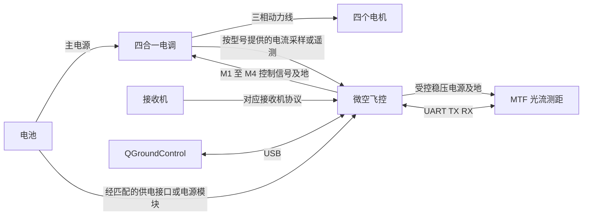

# 硬件清单与接线

[返回目录](README.md)

## 1. 先确认配件匹配

| 配件 | 需要记录的内容 | 核对重点 |
| --- | --- | --- |
| 机架 | 类型、尺寸、安装孔距 | 容纳飞控/电调/电池，光流镜头下方无遮挡 |
| 微空飞控 | 完整型号、硬件版本 | 支持的 PX4 目标、供电范围、UART 与 BEC |
| 四合一电调 | 型号、固件、额定电流 | 电池节数、持续/瞬时电流、DShot 支持、线序 |
| 电机与桨 | 电机 KV、桨直径/桨距、旋向 | 采用厂商匹配数据，不单凭电调额定值决定桨和电池 |
| 电池 | 化学体系、节数、容量、放电能力 | 覆盖动力系统需求，接头和线径匹配 |
| 光流测距模块 | MTF-01、MTF-02 或 MTF-02P 等 | 通信协议、供电、量程、安装方向 |
| 遥控器与接收机 | 协议、供电、通道 | 必须保留人工接管能力；遥控链路与数传链路分开核对 |
| 航向/定位外设 | 磁力计、GNSS 等 | 光流不能代替航向；室外全局定位另行验证 |
| 辅件 | 蜂鸣器、SD 卡、减震柱、电容、线材 | 电容规格和极性遵循电调手册；日志必须可记录 |

MicoAir743v2 的安装孔距为 30.5×30.5 mm，而 NxtPX4v2 使用 20×20 mm；二者不能按同一块板对待。具体供电与端口见各自 [743v2 手册](https://micoair.com/zh/docs/flight-controller/micoair743/micoair743v2-flight-controller-manual) 和 [NxtPX4v2 手册](https://micoair.com/zh/docs/flight-controller/nxtpx4/nxtpx4v2-flight-controller-manual)。

## 2. 机械装配

1. 拆除全部桨叶，断开电池，确认电机螺丝不会顶到绕组。
2. 固定四个电机与电调，预留焊接、散热、USB 和 SD 卡维护空间。
3. 裁剪并焊接电机三相线，检查焊点有无虚焊、连锡或外露导体。转向留待无桨测试确认。
4. 按电调要求安装主电源线和滤波电容，确认正负极；电容工作电压须覆盖该电池的最高充电电压并遵循厂商余量要求。
5. 用合适的减震结构固定飞控，螺母均匀锁紧，避免板弯曲；记录机头、飞控箭头和安装旋转。
6. 在机腹安装光流，镜头朝向地面并保持清洁。镜头、测距发射/接收窗不能被脚架、线束或保护膜遮挡。
7. 接收机天线远离碳板遮蔽和大电流走线；电池固定后检查重心及所有运动部件的间隙。

微空的 [PX4 装机示例](https://micoair.com/zh/docs/flight-controller/flight-controller-guide/px4-flight-controller-configuration-tutorial)可作为工序参考，但示例中的机架、电机通道顺序和动力搭配不等于本机配置。

## 3. 电源与信号关系

这是功能图，不是针脚图。部分板卡经电调线束获得 VBAT，部分经独立电源模块供电；只选手册允许的供电路径，避免向不同稳压源反向灌电。

## 4. 飞控与电调线束

| 信号名称 | 连接原则 |
| --- | --- |
| GND | 电调与飞控的信号参考地连接 |
| M1–M4 / S1–S4 | 电调控制输入接飞控可用电机输出；逻辑 Motor 编号另在 QGC 分配 |
| VBAT / BAT | 仅接允许承受该电池电压的采样或供电端；不能接 UART 或 5V 外设端 |
| CURR | 模拟电流计信号，接对应 ADC；不是电源，也不是串口遥测 |
| TLM / RX 遥测 | 按电调固件支持的协议连接，不能与 CURR 混用 |
| NC | 按对应手册留空 |

同样是 8P 插头，也可能在不同型号之间对调 VBAT、GND 和信号位置。两端分别拍照，按针脚定义逐线确认后再插。参见 [微空四合一电调接口定义](https://micoair.com/zh/docs/esc/esc)。

## 5. MTF 串口接线

MTF-01 的电源是 **5 V**，串口电平是 **3.3 V LVTTL**；供电电压与逻辑电平是两回事。接入前核对具体模块手册，不能把 VBAT 或 12 V 接到 5 V 引脚。

| MTF 模块端信号 | 飞控端信号 |
| --- | --- |
| 5V | 合适的稳压 5V 输出 |
| GND | GND |
| TX | 所选 UART 的 RX |
| RX | 同一个 UART 的 TX |

参见 [MTF-01 接口说明](https://micoair.com/zh/docs/sensors/sensors/mtf-01-sensors)。插头朝向、针脚位置和线色必须看实物与原厂图；不能仅凭这张信号表判断某根线的位置。

## 6. 首次上电

1. 断电检查焊点、导通与极性；电容充电可能让万用表暂时变化，不能把一次蜂鸣当作唯一判断。
2. 保持拆桨，先用 USB 确认飞控能识别。USB 通讯成功不代表外设已供电。
3. 核实电池电压及所有电源输入后，使用适合本机的限流/防短路设备做首次静态上电检查。
4. 用万用表确认外设电源轨与板卡状态；有异常发热、异味、冒烟或电压异常立即断电排查。
5. 电机测试时使用满足动力需求的电源；低功率限流器不能代替正常动力供电，也不能据其跳闸判定电机故障。

NxtPX4v2 的外设供电在仅 USB 连接时可能不启用，须按其手册核实主电源条件。若型号未知，先不要插入动力电池。
