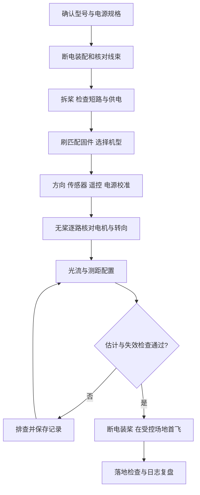

# PX4 微空无人机拼装与设置指南

面向使用微空飞控、四合一电调和下视光流测距模块的四旋翼装机者，按“先装配、再校准、后验证”的顺序建立可追溯的配置流程。

**整理日期：2026-11-19。本文经过官方资料交叉核对，尚未对读者的具体飞机完成接线验收、台架测试或试飞验证。**

## 适用范围

- 主示例：MicoAir743v2 飞控＋兼容的四合一 DShot 电调＋MTF-01 光流测距一体模块。
- 软件基线：PX4 1.16.x；另列 1.12–1.13、1.14–1.16 与 1.17 的差异。厂商固件可能包含额外修改，应同时记录下载来源。
- MTF-02/02P、NxtPX4v2、AIO、743 Lite/v3 必须核对各自手册，不能套用主示例的电源、孔距、接收机口或固件目标。
- 目标是完成基础装机和低速悬停前的检查；不包含载荷投放、长航程、竞速调参或自主任务开发。

光流提供相对地面的运动观测，配合向下测距才能正确估计速度；它不提供绝对位置，也不能替代避障或可靠航向来源。参见 [PX4 光流说明](https://docs.px4.io/v1.16/en/sensor/optical_flow)。

## 按顺序阅读

| 阶段 | 文档 | 完成条件 |
| --- | --- | --- |
| 1 | [硬件清单与接线](01-hardware-wiring.md) | 型号、电压和线序已逐项核实 |
| 2 | [PX4 与 QGroundControl 设置](02-px4-setup.md) | 姿态、遥控、电源和无桨电机测试通过 |
| 3 | [光流与测距配置](03-optical-flow.md) | 数据进入飞控，方向、量程和估计状态正常 |
| 4 | [验证、首次试飞与排障](04-validation-troubleshooting.md) | 各阶段都有记录，具备受控试飞条件 |
| 5 | [逐项检查表](CHECKLIST.md) | 飞前复核，无未解释的解锁警告 |
| 记录 | [装机记录模板](BUILD-RECORD.md) | 固件、端口、参数、日志可复现 |
| 来源 | [官方资料索引](SOURCES.md) | 能回到对应型号及固件版本的说明 |

## 一眼看懂流程

## 三条执行原则

1. 接线、焊接和拆装均断开电池；电机测试、遥控校准和桌面验证均拆除全部螺旋桨。
2. 没有具体硬件型号，就没有通用的“8P 第几针”答案；必须按两端官方 Pinout 和实物丝印核对。
3. 每改一类设置就重启、复查并记录。不能通过关闭解锁检查来掩盖故障。

首次飞行应满足所在地及场地要求，在人员隔离的开阔环境或合适试验设施内，由能接管飞机的操作者执行；按 [PX4 首飞指南](https://docs.px4.io/main/en/flying/first_flight_guidelines)规划。

## 这份资料还需要你补充什么

先填写 [装机记录](BUILD-RECORD.md)：飞控完整型号与硬件版本、电调型号及固件、光流型号及版本、机架、电机/桨、电池、接收机、PX4 完整版本。填齐后才能把本指南变成某一架飞机的最终接线图和参数基线。

本目录是用户仓库中的中文装机资料，不代表 PX4、QGroundControl 或微空科技的官方背书。链接指向原始资料；未转载厂商接口图片或固件。
